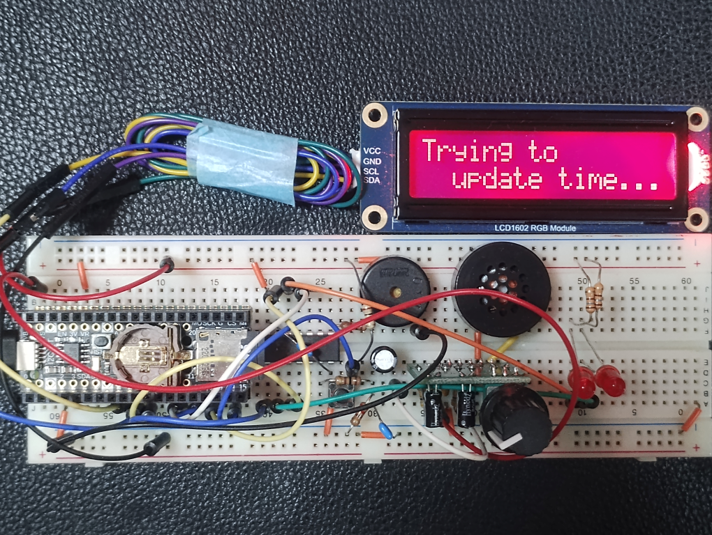
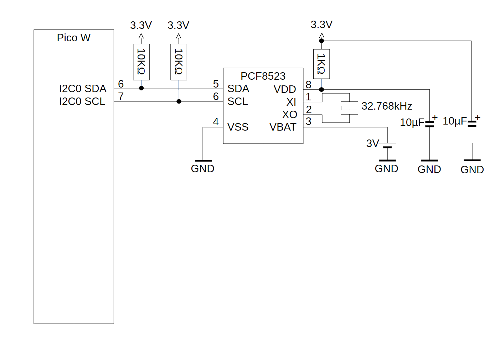
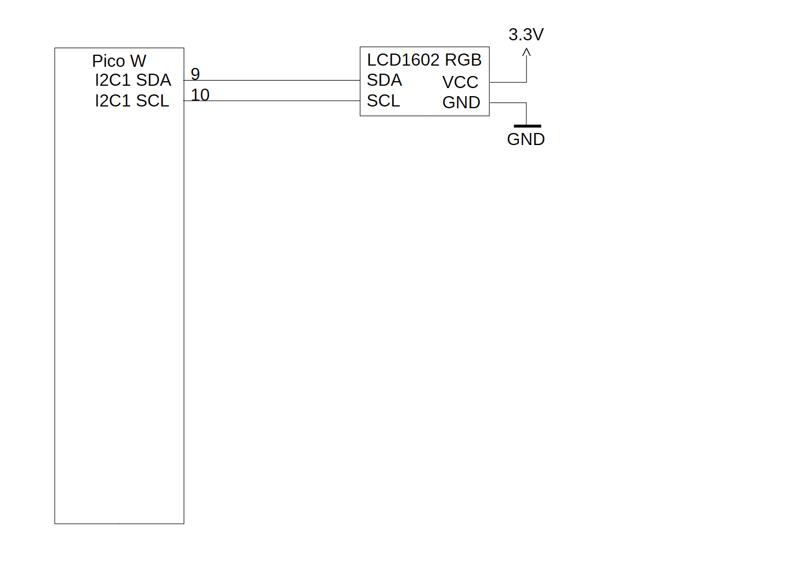
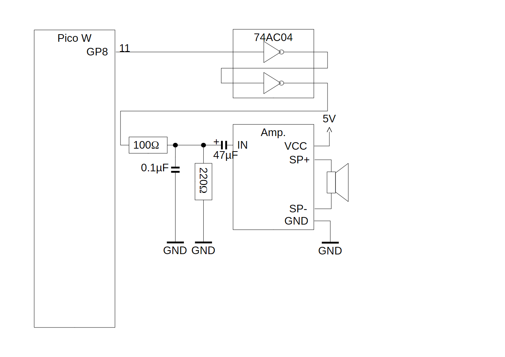
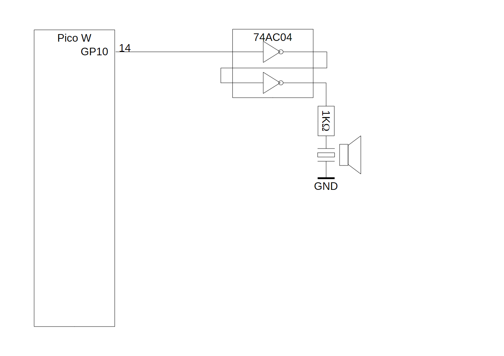
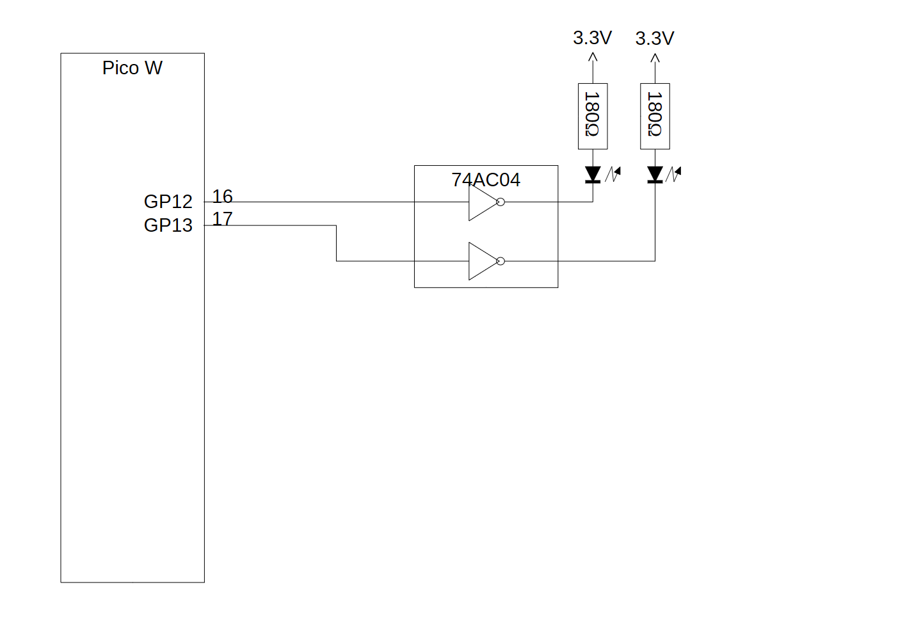
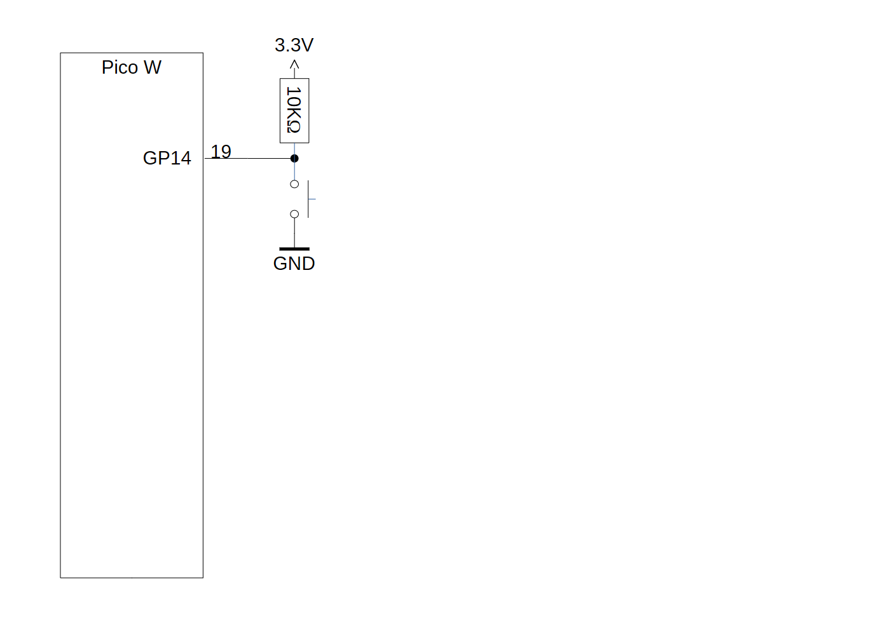
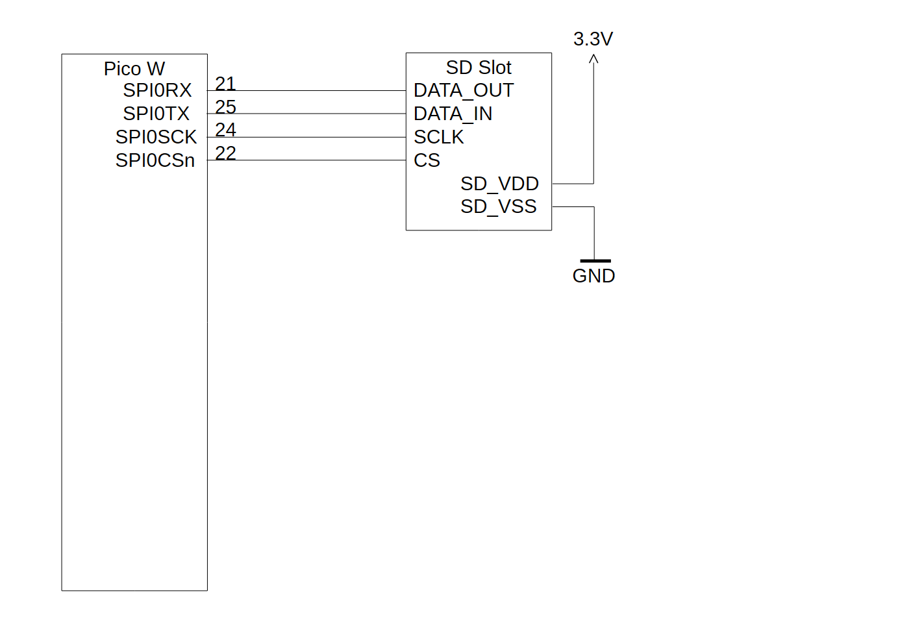

# 音声時計

<div style="text-align:right">2026年10月28日</div>

## 概要

音声で時刻を通知する時計をRaspberry Pi Pico Wを使用して作製しました。

- NTPで時刻合わせをします。
- 液晶キャラクターディスプレイで現在日時を表示します。
- ボタンを押すとその時の日時を発声します。
- 指定した日時にその時の日時を発声します。
- 指定した日時に簡単なメロディーを鳴らします。



## ハードウェア

### 概要

[Raspberry Pi Pico W](https://www.raspberrypi.com/products/raspberry-pi-pico/)に各種デバイスを接続しました。
接続したデバイスを以下に示します。

[PCF8523](https://www.nxp.com/products/analog-and-mixed-signal/real-time-clocks/100-na-real-time-clock-calendar-with-battery-backup:PCF8523)
: リアルタイムクロックチップです。
  NTPによる日時取得に失敗した場合、このチップの時刻を代わりに使用します。

[LCD1602 RGB](https://www.waveshare.com/product/displays/lcd-oled/lcd-oled-3/lcd1602-rgb-module.htm)
: 16 × 2文字の液晶キャラクターディスプレイモジュールです。
  本製作では[Waveshare](https://www.waveshare.com/)製のRGB LEDバックライトを持っているモジュールを使用しました。
  時計として現在日時を表示するために用います。

オーディオアンプ + スピーカー
: 本製作では音声出力用に市販のオーディオアンプユニットを使用しました。
  高音質なものではなく、電子工作用の単純で安価なモノラルアンプを使用しています。
  このアンプユニットに適合するスピーカーを接続し、日時の発声音を再生するために用います。
  ソフトウェアでは音量調整しませんので、ボリュームのついたものを使用しました。

圧電スピーカー
: 一般的なものです。
  特別な要件はありません。
  簡単なメロディーを鳴らすのに用います。

LED
: 一般的な単色のものです。
  動作確認用に2つ使います。

押しボタン
: 押下すると2端子間が接続する一般的なものです。
  押下するとその時の日時を発声します。

SDカードスロット + SDカード
: 特別な要件はありません。
  SDカードは32MB以上あれば十分でしょう。
  音声データと設定情報を保存します。
  本システムではSDカードに対する書き込みは行いません。
  事前に書き込まれたファイルを読み込むだけです。

その他[74AC04](https://toshiba.semicon-storage.com/jp/semiconductor/product/general-purpose-logic-ics/detail.TC74AC04P.html)や各種受動素子を適宜使用しました。

なお、今回の作製では、PCF8523とSDカードスロットの接続を[Adafruit PiCowbell Adalogger for Pico - MicroSD, RTC & STEMMA QT](https://www.adafruit.com/product/5703)によって実現しています。

以下に本システムの回路をデバイス毎に示します。
(Pico Wと74AC04の電源関係の接続は省略されています。74AC04に対しては0.1μF程度のセラミックコンデンサーで電源をバイパスしてください。)

### PCF8523



### LCD1602 RGB



### オーディオアンプ + スピーカー



### 圧電スピーカー



### LED



### 押しボタン



### SDカードスロット + SDカード



## ソフトウェア

### 概要

ソフトウェア作成には[Arduino IDE](https://www.arduino.cc/en/software/#ide)を用いました。
ここでは、Arduino IDE等の導入手順や使用方法の詳細は述べません。
各々のホームページ等を参考にしてください。

Arduino IDEには以下のものを導入しました。

ボードマネージャー
: [Raspberry Pi Pico/RP2040/RP2350 by Earle F. Philhower, III](https://github.com/earlephilhower/arduino-pico)

LCD1602 RGB用ライブラリー
: [DFRobot_RGBLCD1602 by DFRobot](https://github.com/DFRobot/DFRobot_RGBLCD1602)

SDカード用ライブラリー
: [RP2040_SD by Bill Greiman, Khoi Hoang](https://github.com/khoih-prog/RP2040_SD)

上記ボードマネージャーの導入のためには、Arduino IDEのメニューで[基本設定] → [追加のボードマネージャーのURL]に"https://github.com/earlephilhower/arduino-pico/releases/download/global/package_rp2040_index.json"を追加する必要があります。

ボードの設定はほとんどデフォルトのままですが、"CPU Speed"は"250MHz (Overclock)"にしました。

この状態で新規スケッチを作成します。
以下の説明でスケッチの名前は"voice_clock"としていますが、特にこの通りでなくても問題ありません。

### ソースコード

"voice_clock"名で作成したプロジェクトのメインソースファイル`voice_clock.ino`のみで構成しました。
以下にコードを示します。

- [voice_clock.ino](voice_clock.ino)

## ファイル

### 概要

本システムはSDカードのFATもしくはFAT32ファイルシステム上にあるファイルを読み込み動作します。
ファイルを書き込むことはありません。必ず、PC等で必要なファイルを書き込んだSDカードを準備する必要があります。

本システムで必要なファイルは以下の2種類です。

設定ファイル
: ルートディレクトリに`vc.ini`というファイル名で存在するファイルです。
  本システムの各種設定をここに書いておきます。

音声ファイル
: ルートディレクトリに`wav`という名前のディレクトリがあります。
  このディレクトリ以下にさらにディレクトリが存在し、その中に拡張子が"wav"のファイルがいくつか存在します。
  これらは日時を発声するための音声の断片であるWAV形式の音声ファイルです。

### 設定ファイル

以下に`vc.ini`を示します。

- [vc.ini](vc.ini)

設定ファイルの詳細は「[音声時計の設定 - 設定ファイル (vc.ini)](http://akino-yo.f5.si/akino-yo/voice_clock-setting/#%E8%A8%AD%E5%AE%9A%E3%83%95%E3%82%A1%E3%82%A4%E3%83%AB-vc.ini)」を参照してください。

### 音声ファイル

以下に作成した音声ファイル群を示します。
(ZIPアーカイブされています。)

- [wav~made_by_Open-JTalk.zip](wav~made_by_Open-JTalk.zip)

なお、これらの音声ファイルは[Open JTalk](https://open-jtalk.sourceforge.net/)の[デモページ](http://open-jtalk.sp.nitech.ac.jp/)を使用して作成されました。
[利用規約](https://open-jtalk.sp.nitech.ac.jp/index.php?rule=1)に基づき公開・配布させていただきました。

ファイルを解凍すると以下のような構成で解凍されますので、SDカードのルートディレクトリに配置します。

```
/
└─wav
    │
    ├─mon
    │      Jan.wav  「いちがつ」
    │      Feb.wav  「にがつ」
    │      Mar.wav  「さんがつ」
    │      Apr.wav  「しがつ」
    │      May.wav  「ごがつ」
    │      Jun.wav  「ろくがつ」
    │      Jul.wav  「しちがつ」
    │      Aug.wav  「はちがつ」
    │      Sep.wav  「くがつ」
    │      Oct.wav  「じゅうがつ」
    │      Nov.wav  「じゅういちがつ」
    │      Dec.wav  「じゅうにがつ」
    │
    ├─day
    │      01.wav   「ついたち」
    │        :
    │        :
    │      31.wav   「さんじゅういちにち」
    ├─wek
    │      Sun.wav  「にちようび」
    │      Mon.wav  「げつようび」
    │      Tue.wav  「かようび」
    │      Wed.wav  「すいようび」
    │      Thu.wav  「もくようび」
    │      Fri.wav  「きんようび」
    │      Sat.wav  「どようび」
    │
    ├─hor
    │      00.wav   「ぜろじ」
    │        :
    │        :
    │      23.wav   「にじゅうさんじ」
    │
    ├─min
    │      00.wav   「ぜろふん」
    │        :
    │        :
    │      59.wav   「ごじゅうきゅうふん」
    │
    └─msc
           E.wav    「です」
           I.wav    「をおしらせします」
```

音声ファイルの詳細は「[音声時計の設定 - 音声ファイル (*.wav)](http://akino-yo.f5.si/akino-yo/voice_clock-setting/#%E9%9F%B3%E5%A3%B0%E3%83%95%E3%82%A1%E3%82%A4%E3%83%AB-.wav)」を参照してください。

## 動作

- 電源を投入すると以下のメッセージをLCDディスプレイに表示し、ネットワークへの接続、NTPによる日時取得を行います。

  ```
  Trying to       
    update time...
  ```

  この時の無線LANのSSID、パスワード、NTPサーバーアドレスは各々"my_ssid"、"my_password"、"192.168.1.1"です。
  NTPによる日時取得に失敗するとRTCから日時を得ようとします
  その時、バッテリー切れなどでRTCもリセットされているとリブートします。
- NTPによる日時取得は1日に1回行われます。
- タイムゾーンはUTC+9時間です。
- 以下のようなフォーマットで日時を表示します。
  ```
  2025/Jan/02(Fri)
  -=< 12:34:56 >=-
  ```
- GP12につながっているLEDはNTPからの日時取得中に1秒点灯、1秒消灯を繰り返し、日時取得に成功すると点灯します。
- GP13につながっているLEDは1秒点灯、1秒消灯を繰り返します。
- ボタンを押すと「1月2日3時45分です」というふうにボタンを押した時の日時を発声します。
- 8時～18時の毎時正時「12時をお知らせします」というふうに発声し、チャイム音が鳴ります。

少なくとも無線LANアクセスポイント関連設定とNTPサーバー設定は環境に合わせて変更する必要があるでしょう。
無線LANアクセスポイントのSSIDは"ssid="、パスワードは"pass="、NTPサーバー指定は"ntp_server="の後に続けて記述してください。
NTPサーバーはドメイン名指定も可能です。
